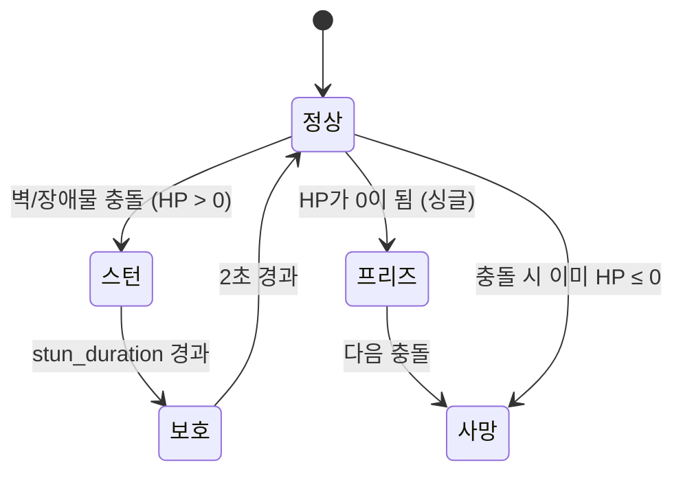

# 01. 게임 기획

플레이어는 오른쪽으로 끝없이 스크롤되는 통로를 날아가며 위아래 벽과 장애물을 피합니다. HP는 시간이 지나면서 계속 줄고 충돌하면 크게 깎입니다. HP가 바닥난 뒤 벽에 부딪히면 끝나며, 그때까지 날아간 거리가 점수입니다.

## 1. 핵심 규칙 요약

| 항목 | 규칙 |
| --- | --- |
| 목표 | 최대한 멀리 날기. 점수 = 비행 거리(m) |
| 화면 | 1280 × 720 고정, 플레이어는 화면 가로 위치가 고정되고 맵이 왼쪽으로 흐름 |
| 상승 | 마우스 왼쪽 버튼을 누르고 있는 동안 상승 |
| 하강 | 버튼을 떼면 자동 하강 |
| 부스트 | 스페이스바를 누르고 있는 동안 스크롤 속도와 거리 증가량 2배 |
| HP 감소 | 시간당 자연 감소(싱글) + 벽/장애물 충돌 데미지 |
| 충돌 | 데미지 → 스턴(정지) → 보호(무적 2초) |
| 종료 | HP 0이 된 뒤 다음 충돌 시 사망(싱글) / 서버 판정(멀티) |
| 랭킹 | 맵별, 캐릭터별 최장 거리 기록을 Notion DB에 저장(싱글만) |

## 2. 조작

| 입력 | 동작 | 코드 |
| --- | --- | --- |
| 마우스 왼쪽 누름 | 상승 시작. 멀티에서는 `MSG_MOVE_UP` 전송 | `CPlayerInGameObject::MoveUpStart` |
| 마우스 왼쪽 유지 | 초당 `Dex` 픽셀만큼 위로 이동 | `MoveUpHold` |
| 마우스 왼쪽 뗌 | 상승 종료. 멀티에서는 `MSG_MOVE_DOWN` 전송 | `MoveUpRelease` |
| (버튼 안 누름) | 초당 `Dex` 픽셀만큼 아래로 이동 | `MoveDown` |
| 스페이스 누름/뗌 | 부스트 켜기/끄기. 멀티에서는 `MSG_BOOST_ON/OFF` 전송 | `BoostModeStart/Release` |
| Z (Debug 빌드만) | 멀티에서 충돌 데미지를 강제로 보냄 (테스트용) | `CPlayerInGameObject::Init` |
| S (Debug 빌드만) | 카메라 흔들림 테스트 | `CCameraObject::Init` |

- 상승과 하강 속도는 같습니다(둘 다 `Dex`). 중력 가속도 개념은 없고, 등속으로 오르내립니다.
- 플레이어 높이는 화면 안(-360 ~ +360)으로 제한됩니다. 화면 밖으로 나갈 수는 없지만, 벽이 화면 안에 있으므로 벽에는 부딪힙니다.
- 조작은 `Start` 상태에서만 됩니다. 카운트다운 중이나 HP 0 이후(`Freze`)에는 입력이 무시되고 하강만 합니다.

## 3. 스탯

캐릭터마다 기본 스탯이 있고, 장착한 아이템이 스탯을 더해 줍니다. 스탯 관리는 `Interface/IPlayerStatController.h`에 있습니다.

| 스탯 | JSON 키 | 의미 |
| --- | --- | --- |
| HP | `hp` | 최대 HP이자 시작 HP |
| Speed | `speed` | 맵 스크롤 속도(px/초). 거리 증가 속도도 결정 |
| Dex | `dex` | 상하 이동 속도(px/초) |
| Def | `def` | 충돌 데미지 차감량, 자연 감소 비율 감소 |
| Stun | `stun_duration` | 충돌 후 스턴 시간(초). 아이템으로 바뀌지 않음 |
| Size | `size_x`, `size_y` | 캐릭터 스프라이트 크기. 충돌 반지름 = 크기 Y × 0.2 |

### 공식

| 계산 | 공식 | 비고 |
| --- | --- | --- |
| 최종 스탯 | 기본값 + 장착 아이템 `add_value` 합 | Speed, Dex, Def |
| HP 아이템 | 시작 HP와 최대 HP를 함께 `add_value`만큼 올림 | `AddHp` |
| 스크롤 속도 | `Speed × 부스트배율` px/초 | 부스트 배율: 켜짐 2.0, 꺼짐 1.0 |
| 거리 증가 | `Speed × dt × 0.01 × 부스트배율` m | 100px = 1m |
| 충돌 데미지 | `max(0, 맵 collision_damage − Def)` | Def가 데미지 이상이면 0 |
| 자연 HP 감소(싱글) | 초당 `1 × (1 − Def / 100)` | Debug 빌드는 10배. 부스트와 무관 |

예: Speed 700이면 초당 7m, 부스트 중에는 14m를 갑니다. Def 10이면 자연 감소는 초당 0.9, 충돌 데미지 20인 맵에서 충돌하면 10이 깎입니다.

> 함수 이름은 `DamagedPerDistance`지만 실제로는 경과 시간(dt)에 비례합니다. 부스트를 켜면 같은 HP로 더 멀리 갈 수 있으므로 부스트는 사실상 이득만 있고, 위험은 빨라진 스크롤 속도뿐입니다.

## 4. HP, 스턴, 보호, 사망

| 상태 | 플레이어 | 맵/장애물 | HP 감소 | 화면 표시 |
| --- | --- | --- | --- | --- |
| 정상 | 조작 가능 | 흐름 | 자연 감소 + 충돌 | 불투명 |
| 스턴 | 이동 불가 | 멈춤 | 없음 | 카메라 흔들림(0.5초, 강도 10) |
| 보호 | 조작 가능 | 흐름 | 없음, 충돌 무시 | 반투명(0.5) |
| 프리즈(싱글) | 조작 불가, 하강만 | 흐름 | - | 캐릭터 색 70%로 어둡게 |
| 사망 | 정지 | 멈춤 | - | 해골 표시(`death.png`) |

- 스턴 중에는 거리도 늘지 않습니다. 맵과 장애물이 내 플레이어의 스턴 여부를 보고 멈추기 때문입니다.
- 보호 시간 2초는 코드 상수입니다(`ReleaseProtection`).
- 싱글에서 HP가 0이 되면 바로 끝나지 않습니다. 조작이 막힌 채 떨어지다가 벽에 닿는 순간 사망합니다. 마지막까지 날아간 거리가 기록됩니다.
- 멀티에서는 HP 0 처리를 서버가 하며, 서버의 `MSG_PLAYER_DEAD`를 받으면 사망합니다.

## 5. 맵

맵은 난이도별로 3개입니다(Easy/Normal/Hard 계열, 아이콘은 웃는/보통/슬픈 얼굴). 데이터는 `map_N.json`에 있습니다([07-data-and-backend.md](07-data-and-backend.md) 참고).

| 속성 | JSON 키 | 효과 |
| --- | --- | --- |
| 이름, 색 | `name`, `color_name` | 벽/장애물/카운트다운 텍스트 색 |
| 난이도 증가량 | `difficulty_rate` | 노드 목록을 한 바퀴 돌 때마다 통로가 위아래로 각각 이만큼(px) 좁아짐 |
| 충돌 데미지 | `collision_damage` | 충돌 1회 데미지 |
| 장애물 간격 | `obstacle_interval_time` | 장애물 생성 주기(초, 싱글) |
| 라인 노드 | `line_node_list[]` | 위쪽 벽 높이 `top_y_pos`, 아래쪽 벽 높이 `bottom_y_pos` (px, 화면 아래 0 ~ 위 720) |

### 벽 생성 방식

- 노드 하나가 가로 300px(= 3m) 구간입니다. 노드 i와 i+1의 높이를 잇는 선분이 벽이 됩니다.
- 화면에는 7개 구간이 보이고, 한 구간이 왼쪽으로 빠지면 오른쪽에 새 구간이 붙습니다(`CLineGroupObject::ArrangeLines`).
- 노드 목록 끝에 도달하면 처음부터 다시 반복합니다. 반복 횟수(사이클)마다 위쪽 벽은 `difficulty_rate`만큼 내려오고 아래쪽 벽은 같은 만큼 올라옵니다. 오래 버틸수록 통로가 좁아지는 구조입니다.
- 노드에 `item_type`, `obstacle_type` 필드가 있지만 현재 코드는 읽지 않습니다(맵 고정 아이템/장애물은 미구현).
- 타이틀 화면의 배경 맵은 사이클이 돌아도 좁아지지 않습니다.

## 6. 장애물

| 항목 | 싱글 | 멀티 |
| --- | --- | --- |
| 생성 주기 | 맵 `obstacle_interval_time`초마다 | 서버가 `MSG_OBSTACLE`로 지시 |
| 크기 | 100 ~ 149px 정사각형(랜덤) | 서버 값 |
| 회전 | 0 ~ 359도(랜덤) | 서버 값 |
| 높이 | 화면 높이 안에서 랜덤 | 서버 값 |
| 충돌 박스 | 크기의 70% OBB | 같음 |
| 이동 | 화면 오른쪽 끝에서 생성, 스크롤 속도로 왼쪽 이동, 왼쪽 끝을 넘으면 비활성 | 같음 |
| 최대 동시 개수 | 10개(오브젝트 풀) | 같음 |

장애물에 부딪힌 결과는 벽과 같습니다(같은 `PROFILE_MAP` 충돌 채널).

## 7. 캐릭터와 아이템

### 캐릭터

5종이며 데이터는 `character_list.json`입니다. 현재 애니메이션은 `PlayerIdle` 하나(새 스프라이트시트 `bird_4x1_798x135.png`, 4프레임)뿐이고, 캐릭터마다 색(`color_name`)과 크기(`size_x/y`)만 바꿔 씁니다(`CPlayerGraphicObject::SetChangeGraphic`). JSON의 `image_sequence_name`으로 시퀀스를 바꿀 수 있지만, 새 시퀀스는 `Animation2DManager.cpp`에 먼저 등록해야 합니다.

### 아이템

- 4종: 체력(우유 아이콘), 스피드(앞으로 화살표), 민첩(날개), 방어(방패).
- 슬롯 수는 `config.json`의 `selectable_item_count`(현재 3)입니다.
- 아이템은 들고 있으면 해당 스탯에 `add_value`를 더하는 패시브 효과만 있습니다. 사용형이나 맵에서 줍는 아이템은 없습니다.
- 로비에서 슬롯을 누르면 아이템 목록이 위로 펼쳐지고, 마우스를 올리면 설명 툴팁이 나옵니다.

## 8. 랭킹

- 싱글플레이에서 사망하면 기록 등록을 시도합니다. 멀티플레이 결과는 등록하지 않습니다.
- 카테고리는 두 가지입니다: **맵별**, **캐릭터별**. 각 카테고리 안에서 값(맵 번호 또는 캐릭터 번호)별로 순위를 매깁니다.
- 카테고리마다 보관하는 최대 기록 수는 `config.json`의 `rank_count_by_category`입니다. 꽉 찼으면 꼴찌보다 멀리 가야 등록되고, 꼴찌 기록은 삭제됩니다.
- 기록이 등록되면 결과 화면에 "New Record"가 표시됩니다.
- 화면별 표시 개수: 로비 간이 랭킹 3위, 결과 화면 5위, 랭킹 화면 10위.

등록 알고리즘의 상세와 문제점은 [07-data-and-backend.md](07-data-and-backend.md#5-랭킹-등록-알고리즘)와 [08-known-issues.md](08-known-issues.md)에 있습니다.

## 9. 싱글과 멀티의 차이

| 항목 | 싱글 | 멀티 |
| --- | --- | --- |
| 서버 | 없음 | 방장 PC에서 서버 exe 실행 |
| 인원 | 1명 | 최대 5명 |
| 맵 선택 | 자유 | 방장만 변경 가능 |
| 시작 | 로비에서 바로 시작 | 방장 외 전원 Ready → 방장이 Start |
| 카운트다운 종료 | 클라이언트 타이머 | 서버 `MSG_COUNTDOWN_FINISHED` |
| 내 높이 | 클라이언트 계산 | 클라이언트 계산(상승/하강 입력만 서버에 보냄) |
| 거리 | 클라이언트 계산 | 서버가 `MSG_PLAYER_DISTANCE`로 알려줌 |
| 자연 HP 감소 | 클라이언트 계산 | 서버 계산(같은 공식, 배율 1배), `MSG_TAKEN_DAMAGE`로 현재 HP 수신 |
| 충돌 데미지 | 클라이언트가 바로 적용 | 데미지 값을 서버에 보내고 결과 HP/스턴을 받음 |
| 장애물 | 클라이언트 랜덤 | 서버가 생성 지시, 모든 클라이언트에 같은 장애물 |
| 사망 판정 | HP 0 후 충돌 | 서버 `MSG_PLAYER_DEAD` |
| 게임 종료 | 내가 죽으면 끝 | 전원 사망 시 서버 `MSG_GAME_OVER` |
| 결과 화면 | 맵/캐릭터 랭킹 + 내 기록 | 참가자 거리 순위 |
| 랭킹 등록 | 함 | 안 함 |
| 다른 플레이어 표시 | 없음 | 서버가 알려준 높이에, 내 거리와의 차이 × 100px 만큼 앞/뒤에 그림. 충돌하지 않음 |
