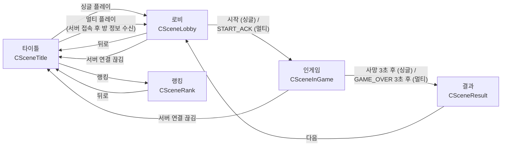
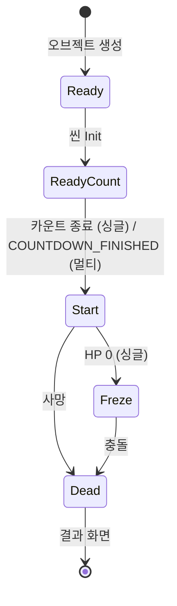

# 02. 화면과 흐름

게임은 5개 씬(`EGameScene`)으로 이뤄집니다. 씬마다 위젯 하나가 화면 UI를 맡고, 씬 전환은 위젯의 `LoadScene()`으로 합니다.

## 공통: 씬 전환과 로딩 화면

- 모든 씬 위젯은 `CSceneWidget`을 상속합니다. 로딩 오버레이(반투명 배경 + 안내 문구 큐)와 `LoadScene()`을 공통으로 제공합니다.
- `LoadScene(타입)`은 백그라운드 스레드(`CTaskManager`)에서 로딩 문구("○○ 화면으로 이동 중입니다")를 띄우고 2초 기다린 뒤 `mScene->GotoXxx()`를 호출합니다. `GotoXxx()`는 플래그만 세우고, 실제 씬 교체는 다음 프레임 메인 스레드의 `CScene::Update`에서 일어납니다.
- 로딩 중(`IsLoading()`)에는 버튼 입력을 무시합니다.

## 1. 타이틀

`Scene/SceneTitle.*`, `UI/UserWidget/TitleWidget.*`

### 처음 진입할 때 데이터 로딩

게임 데이터가 아직 없으면(`GetIsLoadedData() == false`) 순서대로 받아옵니다. 단계마다 안내 문구를 0.5초씩 보여 줍니다.

1. `config.json`
2. 맵 JSON 전체(`map_file_list`)
3. 캐릭터 목록
4. 아이템 목록
5. 스탯 종류 목록
6. 색상 목록
7. 로딩 완료 표시 → 타이틀 배경 오브젝트 생성(`InitObjectAfterDataLoad`)
8. Notion에서 랭킹 전체 조회(`LoadRankData`)

두 번째 진입부터는 이미 받은 데이터를 다시 쓰므로 로딩이 없습니다. 랭킹은 기록 등록 직후에도 다시 조회합니다.

### 배경 데모

데이터 로딩이 끝나면 타이틀 배경에 0번 맵, 장애물, 캐릭터가 깔리고 바로 `Start` 상태가 됩니다. 플레이어가 직접 조작할 수 있는 연습 모드입니다.

- 마우스 왼쪽 버튼과 스페이스바가 인게임과 똑같이 동작합니다.
- 충돌하면 스턴과 카메라 흔들림만 있고 HP나 거리는 없습니다.
- 맵 사이클이 돌아도 통로가 좁아지지 않습니다.

### 버튼

| 버튼 | 동작 |
| --- | --- |
| 싱글 플레이 | 로비로 이동 |
| 멀티 플레이 | 서버 접속 절차 시작(아래) |
| 랭킹 | 랭킹 화면으로 이동 |
| 종료 | 창 닫기 |

버튼에 마우스를 올리면 글자가 초록색으로 바뀝니다.

### 멀티 플레이 접속 절차

1. 윈도우 메뉴의 "다른 방에 참가하기"가 **꺼져 있으면**(= 내가 방장) `../Bin/Server/{Debug|Release}/project-wing-socket-server.exe`를 자식 프로세스로 실행합니다. 켜져 있으면 이 단계를 건너뜁니다.
2. 멀티플레이 모드를 켜고(`SetIsMultiplay(true)`), 메뉴에서 입력한 IP(기본 `127.0.0.1`)의 12345 포트로 TCP 접속합니다.
3. 서버가 닉네임을 묻고(`MSG_WHO_ARE_YOU_REQ`), 클라이언트가 답하면 `MSG_CONNECTED`와 방 전체 정보(`MSG_ROOM_FULL_INFO`)가 옵니다.
4. `MSG_ROOM_FULL_INFO`를 받으면 로비로 이동합니다.
5. `MSG_CONNECTED_REJECT`를 받으면 멀티플레이 모드를 끄고 로딩 화면을 닫습니다. 거절 사유는 화면에 표시하지 않습니다.

자세한 패킷은 [05-network-protocol.md](05-network-protocol.md)를 보세요.

## 2. 로비

`Scene/SceneLobby.*`, `UI/UserWidget/LobbyWidget.*`

로비에서 캐릭터, 아이템, 맵을 고르고 게임을 시작합니다. 화면 중앙에 고른 캐릭터가 실제 크기와 색으로 표시됩니다.

### 공통 구성

| 영역 | 내용 |
| --- | --- |
| 캐릭터 선택 | 좌우 화살표로 순환. 이름, HP, Speed, Dex, Def, Stun, Size 표시. 아이템 보너스는 수치 옆에 더해서 보여 줌 |
| 아이템 슬롯 | 슬롯 3개. 슬롯을 누르면 위로 아이템 4종 목록이 펼쳐지고, 고르면 슬롯에 아이콘이 들어감. 마우스를 올리면 이름/설명/스탯/추가값 툴팁 |
| 맵 선택 | 좌우 화살표로 순환. 난이도 아이콘이 위아래로 흔들리는 애니메이션. 이름, 색, 난이도 증가량, 충돌 데미지 표시 |
| 다음 버튼(오른쪽 아래 화살표) | 싱글: 시작 / 멀티: 방장은 Start, 나머지는 Ready 토글 |
| 이전 버튼(왼쪽 위 화살표) | 타이틀로 이동. 닉네임 입력 팝업이 열려 있으면 무시 |

로비에 들어올 때마다 선택값(캐릭터 0번, 맵 0번, 아이템 슬롯 비움)이 초기화됩니다(`InitCurSelectedData`).

### 싱글 전용

- 오른쪽에 **간이 랭킹** 두 개가 나옵니다: 지금 고른 캐릭터의 상위 3명, 지금 고른 맵의 상위 3명. 캐릭터나 맵을 바꾸면 즉시 갱신됩니다.

### 멀티 전용

- 간이 랭킹 대신 **참가자 목록**(최대 5칸)이 나옵니다. 칸마다 닉네임, 방장 왕관, 내 칸 강조 배경이 있고, Ready했거나 방장이면 밝게, 아니면 반투명하게 표시됩니다. 빈 칸은 "Player_Empty"류 문구입니다.
- 맵 화살표는 방장에게만 보입니다. 방장이 맵을 바꾸면 모든 참가자의 맵 정보가 바뀝니다.
- 캐릭터, 아이템, 맵을 바꿀 때마다 서버에 알리고(`MSG_PICK_*`), 다른 사람의 변경은 서버 메시지로 받아 참가자 목록을 갱신합니다.
- 방장이 Start를 누르면 서버가 전원 Ready인지 확인해 `MSG_START_ACK`를 보냅니다. 값이 1이면 모두 인게임으로 이동합니다.
- 서버 연결이 끊기면(`MSG_END`) 타이틀로 돌아갑니다.

## 3. 인게임

`Scene/SceneInGame.*`, `UI/UserWidget/InGameWidget.*`

### 진행 상태 (`EGamePlayState`)

- 씬이 상태를 바꾸면 `IGamePlayStateController`를 구현한 모든 객체(내 플레이어, 다른 플레이어, 벽, 장애물, HUD)에 같은 상태가 전달됩니다.
- 게임 로직(이동, 거리, HP)은 `Start`와 `Freze`에서만 돌고, 조작은 `Start`에서만 됩니다.
- `Pause`, `Exit`, `End` 상태는 enum에만 있고 아직 쓰이지 않습니다.

### 카운트다운

화면 가운데에 "Ready" → "3" → "2" → "1" → "Start"가 1초 간격으로 맵 색깔로 표시됩니다. 싱글은 "Start" 다음 초에 시작하고, 멀티는 서버의 `MSG_COUNTDOWN_FINISHED`를 받아야 시작합니다. 시작하면 카운트다운이 사라지고 거리 표시가 나타납니다.

### HUD

| 요소 | 내용 | 코드 |
| --- | --- | --- |
| HP 게이지 | 현재 HP / 최대 HP 비율로 앞쪽 바 길이가 줄어듦 | `InitTargetPlayerStat`, `UpdateTargetPlayerStat` |
| 거리 | `123m` 형식, 맵 색, 화면 오른쪽 | `InitStartCountAndMyDistanceText` |
| 장착 아이템 | 고른 아이템 아이콘 3칸 | `InitSelectedItemSlot` |
| 다른 플레이어 정보(멀티) | 참가자별 닉네임, 거리, HP 게이지. 카운트다운 중에는 갱신 안 함 | `InitOtherPlayersInfo`, `UpdateOtherPlayersInfo` |

UI 좌표계는 `CWidget::CreateUIProjection`(1280×720)을 따르며 원점이 **왼쪽 아래**, y축이 위쪽입니다. 정확한 배치는 각 `Init*` 함수의 `SetPos` 값을 보세요.

### 끝나는 과정

- **싱글:** 사망하면 해골 표시 → 3초 대기 → Notion에 기록 등록 시도 → 결과 화면으로 이동. 등록 여부("New Record")는 결과 화면에 전달됩니다.
- **멀티:** 내가 죽으면 `Dead` 상태로 멈추고 다른 사람들을 지켜봅니다. 서버가 `MSG_GAME_OVER`를 보내면 3초 뒤 모두 결과 화면으로 갑니다. 다른 플레이어가 죽으면 그 캐릭터 위에 해골이 뜹니다.
- 인게임 중 서버 연결이 끊기면 타이틀로 이동합니다.

## 4. 결과

`Scene/SceneResult.*`, `UI/UserWidget/ResultWidget.*`

| 모드 | 화면 |
| --- | --- |
| 싱글 | 위쪽에 맵/캐릭터 탭과 하위 탭이 있는 랭킹 표(상위 5위), 아래에 내 이번 기록(닉네임, 맵, 캐릭터, 아이템, 거리). 등록됐으면 초록색 "New Record" |
| 멀티 | 이번 판 참가자 전원을 거리 내림차순으로 정렬한 표 |

다음 버튼을 누르면 이번 결과를 지우고 로비로 갑니다. 멀티에서는 참가자별 인게임 상태(Ready, HP, 거리, 아이템 등)를 초기화한 뒤 같은 방 로비로 돌아갑니다.

## 5. 랭킹

`Scene/SceneRank.*`, `UI/UserWidget/RankWidget.*`

- 메인 탭: **맵별** / **캐릭터별**
- 하위 탭: 맵이면 맵 번호별, 캐릭터면 캐릭터 번호별
- 선택한 탭의 기록을 거리 내림차순으로 상위 10위까지 보여 줍니다. 열: 순위, 닉네임, 맵, 캐릭터, 아이템 3개, 거리.
- 데이터는 타이틀에서 받은(또는 기록 등록 후 갱신된) 메모리 캐시를 씁니다. 랭킹 화면에서 새로 조회하지 않습니다.
- 뒤로 버튼으로 타이틀에 돌아갑니다.

## 6. 윈도우 메뉴 바와 창 제목

게임 창 위쪽 Win32 메뉴 바로 닉네임, 멀티 접속 대상, 언어를 정합니다(`CGameManager::UpdateMenu`).

| 메뉴 | 항목 | 동작 |
| --- | --- | --- |
| 닉네임 | 닉네임 입력 | 팝업에서 입력. 멀티 접속 중이면 서버에 `MSG_CHANGE_NICKNAME` 전송 |
| 멀티플레이 | 다른 방에 참가하기(체크) | 켜면 "방장 IP" 메뉴가 생기고, 멀티 플레이 시 서버를 띄우지 않음. 끄면 IP가 `127.0.0.1`로 돌아감 |
| 방장 IP | IP 입력 | 체크가 켜졌을 때만 보임. 접속할 서버 IP 입력 |
| Language | English / 한국어 | 언어 변경. 메뉴와 창 제목은 즉시, 게임 UI는 다음 화면 전환부터 반영 |

창 제목은 `ProjectWing | Nickname: <닉네임> | Host IP: <IP>` 형식이며 닉네임이나 IP를 바꾸면 갱신됩니다. 닉네임 기본값은 `Unknown`입니다.
