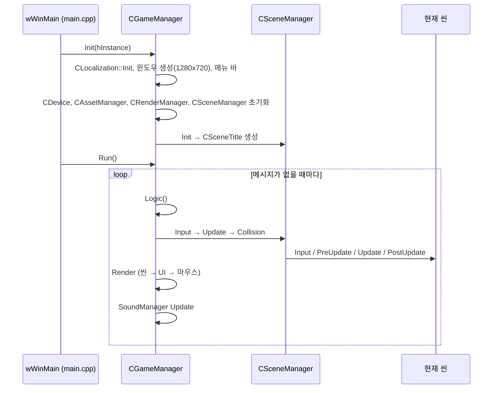
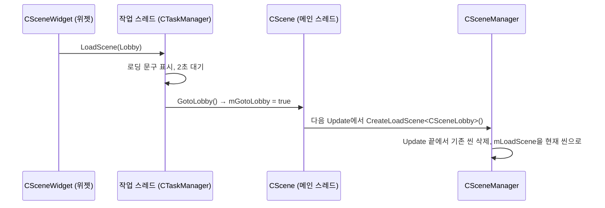
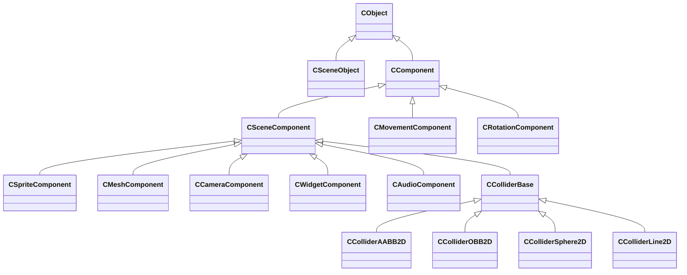

# 03. 클라이언트 엔진 (Common, AssetProj)

엔진은 정적 라이브러리 두 개입니다. `Common`이 윈도우, 메인 루프, 씬, 컴포넌트, 렌더링, 입력, UI를 맡고, `AssetProj`가 에셋 로딩과 셰이더를 맡습니다. 둘 다 x64 정적 lib으로 빌드되어 `KDT2Framework`(exe)에 링크됩니다.

> 주의: `Common`은 순수 엔진이 아닙니다. include 경로에 `KDT2Framework/Include`가 들어 있고, `Scene/SceneManager.cpp`와 `Scene/Scene.cpp`가 게임 씬(`CSceneTitle` 등)을, `GameManager.cpp`가 `Etc/`의 게임 매니저들(`CDataStorageManager`, `CNetworkManager`, `CMultiplayManager`, `CLocalization` 등)을 직접 include합니다. 게임 쪽 씬이나 매니저를 바꾸면 `Common`도 다시 빌드해야 합니다.

## 1. 시작과 메인 루프

- `CGameManager::Run()`은 `PeekMessage` 루프입니다. 윈도우 메시지가 없을 때마다 `Logic()`을 한 번 돌립니다. 프레임 제한은 없습니다.
- `Logic()` 순서: `CTimer::Update()`로 DeltaTime 계산 → `Input` → `Update`(씬 교체가 일어나면 이번 프레임의 나머지 생략) → `Collision` → `Render` → 사운드 업데이트.
- 해상도는 1280×720 창 모드로 고정입니다(`CDevice::Init(mhWnd, 1280, 720, true)`).
- 윈도우 프로시저(`CGameManager::WndProc`)가 메뉴 바 명령(닉네임, 멀티 IP, 언어)과 입력 팝업을 처리합니다. 자세한 메뉴는 [02-screens-and-flow.md](02-screens-and-flow.md#6-윈도우-메뉴-바와-창-제목)에 있습니다.

## 2. 씬

### 수명주기

`CScene::Init()`이 씬별 매니저를 만들고 가상 함수 세 개를 순서대로 부릅니다.

| 순서 | 생성되는 것 |
| --- | --- |
| 1 | `CInput`, `CCameraManager`, `CSceneCollision`, `CSceneAssetManager`, `CSceneUIManager` |
| 2 | `InitAsset()` — 씬 전용 에셋 |
| 3 | `InitObject()` — 게임 오브젝트 |
| 4 | `InitWidget()` — UI 위젯 |

오브젝트가 위젯보다 먼저 만들어지므로, 위젯은 `Init`에서 씬의 오브젝트(예: 내 플레이어)를 찾아 쓸 수 있습니다. 반대로 오브젝트가 위젯을 써야 하면 씬 `Init` 이후에 연결합니다(`CSceneInGame::Init`이 카운트다운 위젯을 쓰는 방식).

매 프레임 씬은 `Input → PreUpdate → Update → PostUpdate → Collision → Render` 순으로 오브젝트 리스트를 돌고, `IsActive()`가 false인 오브젝트를 `PostUpdate`에서 리스트에서 뺍니다.

### 씬 교체

- `GotoTitle/Lobby/InGame/Result/Rank()`는 플래그만 세웁니다. 실제 생성은 메인 스레드의 `CScene::Update`가, 교체는 `CSceneManager::Update` 끝에서 합니다. 새 씬은 교체 전에 이미 `Init`이 끝난 상태입니다.
- 이전 씬은 `SAFE_DELETE`로 바로 지워집니다. 씬 간에 넘길 데이터는 싱글턴(`CDataStorageManager`, `CMultiplayManager`)에 둡니다.
- 새 씬을 추가하려면 `EGameScene`, `CScene`의 `mGotoXxx` 플래그와 `GotoXxx()`, `CScene::Update`의 분기, `CSceneManager::SetCurrentSceneType`, `CSceneWidget::LoadScene`의 분기를 함께 고쳐야 합니다.

## 3. 오브젝트와 컴포넌트

- **`CObject`**: 참조 카운트(`AddRef/Release`)와 활성 상태를 가진 기반 클래스. `CSharedPtr<T>`가 참조 카운트를 관리합니다.
- **`CSceneObject`**: 씬에 놓이는 게임 오브젝트. 루트 `CSceneComponent`를 하나 갖고(`SetRootComponent`), 그 아래 컴포넌트 트리를 만듭니다. 생성은 `mScene->CreateObj<T>(이름)`.
- **`CSceneComponent`**: 위치/회전/크기(로컬, 월드)를 갖고 부모-자식 트리를 이룹니다. `AddChild`로 붙이면 부모 변환을 따라갑니다.
  - 위치 규칙: `월드 위치 = 상대 위치 × 부모 월드 회전 + 부모 월드 위치`. `SetRelativePos`, `SetWorldPos`(역회전으로 상대 위치를 구함), `SetWorldRotation`/`SetRelativeRotation`, `AddChild`(`ComputeTransform`)가 모두 이 규칙을 따르고, 자식과 손자까지 재귀로 다시 배치합니다.
  - 그래서 자식은 부모만 옮기면 같이 움직입니다. 부모와 자식을 둘 다 `SetWorldPos`로 옮기면 자식이 두 번 이동합니다.
  - 예외: `SetRelativeScale`은 자식 위치에 부모 스케일을 곱하고 회전은 무시하는 옛 방식 그대로입니다([08. 알려진 이슈](08-known-issues.md#코드-안정성)).
- **`CMovementComponent`, `CRotationComponent`**: 변환 없이 `CComponent`를 바로 상속한 로직 컴포넌트(이동, 회전).
- 컴포넌트 생성은 오브젝트 안에서 `CreateComponent<T>(이름)`.
- 콜라이더 4종(AABB, OBB, Sphere, Line)의 실제 구현은 게임 프로젝트 `KDT2Framework/Include/Component/`에 있고, 충돌 계산은 `Scene/Collision.*`에 있습니다.

### 자주 쓰는 컴포넌트

| 컴포넌트 | 용도 |
| --- | --- |
| `CSpriteComponent` | 2D 스프라이트. 텍스처, 색, 투명도, 피벗, `CAnimation2D` 재생 |
| `CWidgetComponent` | 월드 공간에 위젯을 붙임(캐릭터 머리 위 디버그 텍스트 등) |
| `CCameraComponent` | 카메라. `CCameraObject`가 들고 있고 흔들림 효과를 줌 |
| `CAudioComponent` | FMOD 사운드 재생(현재 게임 코드에서는 사용 안 함) |
| `CTileMapComponent` 등 | 타일맵(엔진 기능, 현재 게임에서 사용 안 함) |

## 4. 충돌

- 씬마다 `CSceneCollision`이 있고, 콜라이더가 생성되면 자동 등록됩니다. 매 프레임 쿼드트리(`CollisionQuadTree`)로 후보를 나눈 뒤 쌍마다 겹침을 검사합니다.
- 충돌 시작/끝 콜백: `SetCollisionBeginFunc<T>(this, &T::Func)`. 콜백 시그니처는 `(const FVector3D& HitPoint, CColliderBase* Dest)`입니다.
- 마우스와 UI의 충돌도 이 단계에서 처리합니다(`CSceneUIManager::CollisionMouse`).

### 충돌 프로파일 (`Common/Include/ProfileManager.cpp`)

| 프로파일 | 채널 | Default | PlayerMine | PlayerOther | Map |
| --- | --- | --- | --- | --- | --- |
| `Default` | Default | 무시 | 무시 | 무시 | 무시 |
| `PlayerMine` | PlayerMine | 무시 | 무시 | 무시 | **충돌** |
| `PlayerOther` | PlayerOther | 무시 | 무시 | 무시 | 무시 |
| `Map` | Map | 무시 | **충돌** | 무시 | 무시 |

내 플레이어와 맵(벽, 장애물) 사이에서만 충돌이 일어납니다. 다른 플레이어끼리는 서로 통과합니다.

## 5. 렌더링

- `CRenderManager`가 레이어(`BackGround`, `Object`)별 렌더 목록을 정렬해 그립니다. 정렬 방식은 None/Y/Z/Alpha 중 선택합니다.
- 렌더 상태(블렌드, 깊이)는 `CRenderStateManager`가 이름으로 관리합니다.
- 월드 좌표계는 화면 중앙이 원점(0, 0)이고 y축이 위쪽입니다. 화면 범위는 x ±640, y ±360입니다.
- UI 좌표계는 화면 왼쪽 아래가 원점이고 y축이 위쪽입니다(`CWidget::CreateUIProjection`).

### 셰이더 (`AssetProj/Include/Shader`, `KDT2Framework/Bin/Shader`)

셰이더는 실행할 때 `.fx`를 `D3DCompileFromFile`로 컴파일합니다(Debug 빌드는 디버그 플래그 포함).

| 셰이더 클래스 | 파일 | 용도 |
| --- | --- | --- |
| `CSpriteShader` | `Sprite.fx` | 스프라이트, 애니메이션 |
| `CUIShader` | `UI.fx` | UI 위젯 |
| `CColorMeshShader`, `CFrameMeshShader` | `ColorMesh.fx` | 단색 메시, 콜라이더 디버그 외곽선 |
| `CStaticMeshShader` | `Mesh.fx` | 기본 머티리얼 메시 |
| `CTileMapShader`, `CTileShader` | `TileMap.fx` | 타일맵 |
| (공용) | `Share.fx` | 공용 상수 버퍼와 함수 |

상수 버퍼는 종류별 클래스(`CTransformCBuffer`, `CSpriteCBuffer`, `CUICBuffer`, `CAnimation2DCBuffer`, `CColliderCBuffer`, `CMaterialCBuffer`, `CTileMapCBuffer`)로 나뉘어 있습니다.

## 6. 에셋 (`AssetProj/Include/Asset`)

`CAssetManager`(싱글턴) 아래에 종류별 매니저가 있습니다. 씬은 `CSceneAssetManager`를 거쳐 접근합니다.

| 매니저 | 관리 대상 | 비고 |
| --- | --- | --- |
| `CMeshManager` | 기본 사각형 메시 등 | |
| `CTextureManager` | PNG 등 텍스처 | DirectXTex로 로드 |
| `CMaterialManager` | 머티리얼 | |
| `CShaderManager` | 셰이더, 상수 버퍼 | |
| `CFontManager` | 폰트 | DirectWrite. `NotoSansKR-Regular/Bold.otf` |
| `CSoundManager` | 사운드 | FMOD. 매 프레임 `Update` |
| `CAnimation2DManager` | 2D 애니메이션 시퀀스 | 현재 `PlayerIdle`(새 스프라이트시트) 하나 |

### 파일 경로 규칙

경로의 기준이 두 가지라서 실행 위치에 주의해야 합니다.

| 대상 | 기준 | 실제 경로 |
| --- | --- | --- |
| 텍스처, 폰트, 사운드 | **exe 폴더** + `../Bin/Asset/` | `KDT2Framework/Bin/Asset/` |
| 셰이더 | **현재 작업 폴더** + `../Bin/Shader/` | `KDT2Framework/Bin/Shader/` |
| 스프라이트시트 JSON | 현재 작업 폴더 + `../Bin/Asset/Texture/SpriteSheet/` | |
| 서버 exe | 현재 작업 폴더 + `../Bin/Server/{Debug,Release}/` | |
| CA 인증서 | 현재 작업 폴더 + `./pem/cacert.pem` | `KDT2Framework/Debug/pem`, `KDT2Framework/Release/pem`, `KDT2Framework/Include/pem` 모두 있음 |

exe 폴더(`KDT2Framework/Debug` 또는 `KDT2Framework/Release`)를 작업 폴더로 실행하거나, Visual Studio 디버거로 실행(작업 폴더 = `KDT2Framework/Include`)하면 둘 다 맞습니다. 다른 폴더에서 exe를 실행하면 셰이더와 인증서를 못 찾습니다.

## 7. UI 프레임워크

- **`CWidget`**: 모든 UI의 기반. 위치, 크기, 피벗, 색, 투명도, ZOrder, 활성 여부.
- **기본 위젯** (`Common/Include/UI/Common`): `CButton`(상태별 텍스처, Hovered/Unhoverd/Click 콜백), `CImage`, `CTextBlock`(DirectWrite, 정렬, 그림자), `CProgressBar`, `CTitleBar`.
- **`CUserWidget`**: 여러 위젯을 묶는 컨테이너. `AddWidget`으로 자식을 넣습니다. 게임의 화면 위젯(`CSceneWidget` 파생)은 모두 이것을 상속합니다.
- **`CWindowWidget`**: 창 형태 위젯.
- 생성: `mScene->GetUIManager()->CreateWidget<T>(이름)`, 화면에 올리기: `AddToViewport(widget)`.
- `CSceneUIManager`가 ZOrder로 정렬해 그리고, 마우스 충돌은 위에 있는 위젯부터 검사합니다.

### 로컬라이징

UI 문구는 `KDT2Framework/Include/Etc/Localization.*`의 `LOC(키)`로 가져옵니다(영어/한국어). 규칙은 [CLAUDE.md](../CLAUDE.md)의 "로컬라이징" 절을 보세요.

## 8. 입력 (`Common/Include/Scene/Input.*`)

- 씬마다 `CInput`이 있습니다. 키보드는 DirectInput 또는 Win32 방식 중 하나로 읽습니다(`EInputSystem_Type`).
- 바인딩: `AddBindKey("이름", 키)` 후 `AddBindFunction<T>("이름", EInputType::Down|Hold|Up, this, &T::Func)` 또는 람다. 한 이름에 Down/Hold/Up 콜백을 따로 걸 수 있습니다.
- Ctrl/Alt/Shift 조합 키도 지원합니다.
- 마우스 왼쪽 버튼은 `VK_LBUTTON`으로 키처럼 바인딩합니다(인게임 상승).

## 9. 스레드

| 스레드 | 만드는 곳 | 하는 일 |
| --- | --- | --- |
| 메인 | `wWinMain` | 윈도우 메시지, 게임 루프, 렌더링 |
| 작업 스레드(여러 개) | `CTaskManager::AddTask` | 데이터 로딩(HTTP), 씬 전환 대기, 랭킹 등록, 서버 프로세스 실행. 만들자마자 `detach` |
| 네트워크 수신 | `CNetworkManager::ConnetServer` | 서버 메시지를 받아 큐에 넣음 |
| 하트비트 | 같음 | 1초마다 `MSG_HEARTBEAT` 전송 |

- 네트워크 메시지 큐만 뮤텍스로 보호합니다. 메인 스레드가 매 프레임 `PollMessage`로 꺼냅니다.
- 작업 스레드는 위젯 표시, 씬 플래그, 싱글턴 데이터를 락 없이 건드립니다. 현재는 메인 스레드와 동시에 같은 데이터를 쓰는 경우가 드물어 문제가 드러나지 않을 뿐이므로, 작업 스레드에서 새 로직을 추가할 때는 결과를 플래그나 큐로 메인 스레드에 넘기는 방식을 권합니다.

## 10. 기타 공용 기능

| 기능 | 위치 | 설명 |
| --- | --- | --- |
| 로그 | `Share/Log.*` | `CLog::PrintLog(문자열)`. 콘솔 출력과 로그 파일(작업 폴더 기준 `../Bin/Log/<시각>.txt`, gitignore) |
| 타이머 | `Share/Timer.*` | 고해상도 DeltaTime, FPS |
| 수학 | `Vector2D/3D/4D`, `Matrix.h`, `EngineMath.h` | `FVector3D::Axis[EAxis::Y]` 같은 상수, `FVector4D::GetColorFromString("Cyan")` |
| 싱글턴 매크로 | `GameInfo.h` | `DECLARE_SINGLE`, `DEFINITION_SINGLE` |
| 공용 enum | `GameInfo.h` | `EGameScene`, `EGamePlayState`, `ERankMenuTap`, 충돌 채널 등 |

## 11. Debug / Release 빌드 차이

`_DEBUG` 매크로로 갈리는 동작입니다. Debug 빌드는 개발용 표시와 치트가 켜져 있어 실제 플레이와 다르게 보이므로, 화면이나 밸런스를 확인할 때는 Release로 빌드합니다.

| 항목 | Debug | Release | 위치 |
| --- | --- | --- | --- |
| 콘솔 로그 창 | 열림(`AllocConsole`) | 없음 | `Common/Include/Share/Log.cpp` |
| 콜라이더 외곽선 | 그림(`FrameMeshShader`) | 안 그림 | `Component/Collider*.cpp` |
| 쿼드트리 영역 | `mDebugQuadTree`가 켜져 있으면 그림 | 안 그림 | `Common/Include/Scene/Scene.cpp`, `Scene/CollisionQuadTree.cpp` |
| 플레이어 디버그 텍스트 | 표시 | 숨김 | `Object/PlayerGraphicObject.cpp` |
| 플레이어 투명도 | 0.8 | 1.0 | `PlayerInGameObject.cpp`, `PlayerTitleObject.cpp` |
| 벽 스프라이트 투명도 | 0.5 | 기본값 | `Object/LineGroupObject.cpp` |
| 테스트 키 | `Z` 충돌 데미지(멀티), `S` 카메라 흔들기 | 없음 | `PlayerInGameObject.cpp`, `CameraObject.cpp` |
| 거리 비례 HP 감소(싱글) | 10배 | 1배 | `PlayerInGameObject::UpdateDecreaseHp` |
| 로딩 스레드 대기 | 10ms | 50ms | `UI/UserWidget/SceneWidget.cpp` |
| 서버 exe | `../Bin/Server/Debug/`, 새 콘솔 창 | `../Bin/Server/Release/`, 창 없음 | `Etc/ProcessManager.cpp` |
| Notion 요청 JSON | 들여쓰기(`dump(4)`) | 한 줄 | `Etc/NotionDBController.cpp` |
| D3D11 디바이스 | 디버그 레이어(`D3D11_CREATE_DEVICE_DEBUG`) | 일반 | `Common/Include/Device.cpp` |
| 셰이더 컴파일 | `D3DCOMPILE_DEBUG`, 오류 문구 출력 | 플래그 없음 | `AssetProj/Include/Shader/*.cpp` |
| 링크 라이브러리 | `DirectXTex_Debug.lib`, `../Debug/fmod_vc.lib` | `DirectXTex.lib`, `../Release/fmod_vc.lib` | `Texture.cpp`, `Sound.cpp` |
