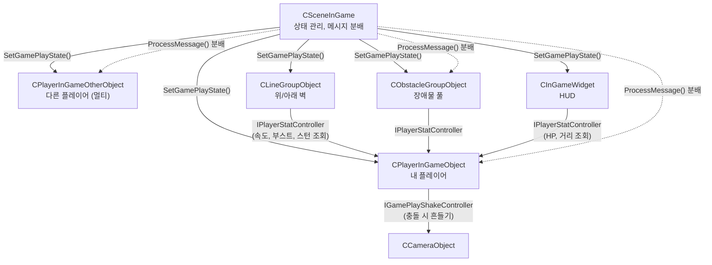

# 04. 클라이언트 게임 코드 (KDT2Framework)

`KDT2Framework/Include`가 실행 파일 프로젝트이며 게임 규칙, 화면, 네트워크, 외부 데이터 연동이 모두 여기 있습니다. 엔진 기반 클래스는 [03-client-engine.md](03-client-engine.md)를 보세요.

## 1. 폴더별 구성

| 폴더 | 내용 |
| --- | --- |
| `main.cpp` | `wWinMain`. `CGameManager` 초기화와 실행, 예외 로그 |
| `Scene/` | 씬 5개(Title, Lobby, InGame, Result, Rank), 충돌 시스템(`SceneCollision`, `CollisionQuadTree`, `Collision`) |
| `Object/` | 게임 오브젝트: 플레이어 3종, 벽, 장애물, 카메라 |
| `Component/` | 2D 콜라이더 4종과 기반 클래스 |
| `UI/UserWidget/` | 화면 위젯(씬당 하나), 플레이어 머리 위 위젯, 디버그 위젯 |
| `Interface/` | 객체 간 역할 인터페이스(스탯, 플레이 상태, 네트워크, 카메라 흔들림, 그래픽 교체) |
| `Etc/` | 싱글턴 매니저(데이터, 네트워크, 멀티 상태, HTTP, Notion, 작업 스레드, 프로세스, 로컬라이징), 상수 |
| `pem/` | libcurl용 CA 인증서(VS 디버거 실행 시 사용) |
| `curl-8.12.1_1-win64-mingw/`, `json-develop/` | 외부 라이브러리. 수정하지 않음 |

## 2. 씬

| 클래스 | 구현 인터페이스 | 만드는 오브젝트 | 위젯 |
| --- | --- | --- | --- |
| `CSceneTitle` | `ISceneNetworkController`, `IScenePlayerGraphicController` | (데이터 로드 후) 카메라, 벽, 장애물, `CPlayerTitleObject` | `CTitleWidget` |
| `CSceneLobby` | `ISceneNetworkController`, `IScenePlayerGraphicController` | 카메라, `CPlayerGraphicObject`(선택 캐릭터 미리보기) | `CLobbyWidget` |
| `CSceneInGame` | `ISceneNetworkController`, `IScenePlayerGraphicController` | 카메라, 벽, 장애물, 내 플레이어, 다른 플레이어들 | `CInGameWidget` |
| `CSceneResult` | - | 없음 | `CResultWidget` |
| `CSceneRank` | - | 없음 | `CRankWidget` |

타이틀과 인게임 씬은 인터페이스가 아닌 자체 멤버(`mGamePlayState`, `mArrGamePlayStateCtlr`)로 플레이 상태를 관리하고, `SetGamePlayState()`로 하위 객체에 전파합니다. 결과/랭킹 씬은 네트워크 메시지를 처리하지 않습니다.

네트워크를 쓰는 씬은 매 프레임 `ProcessMessage()`에서 큐를 비우고, 메시지마다 `DistributeMessage()`로 등록된 리스너 전부에 넘긴 뒤 씬 자신이 처리할 메시지(예: `MSG_END`, `MSG_GAME_OVER`)를 처리합니다.

## 3. 인게임 객체 연결

`CSceneInGame::InitObject()`가 객체를 만들고 인터페이스로 서로 연결합니다.

- 벽과 장애물은 스스로 속도를 갖지 않습니다. 매 프레임 내 플레이어의 `GetSpeed() × GetBoostValue()`만큼 왼쪽으로 움직이고, 내 플레이어가 스턴이면 멈춥니다. 플레이어가 앞으로 나는 것처럼 보이는 이유입니다.
- 벽 구간 하나는 스프라이트 1개와 그 자식 콜라이더 라인 2개(벽 선분, 벽 바깥을 막는 세로선)로 이뤄집니다. 스크롤할 때는 스프라이트만 옮기고 콜라이더는 부모를 따라 움직입니다(`CLineGroupObject::MoveLines`). Debug에서 각 구간 시작점에서 화면 위/아래 끝까지 뻗은 세로 초록선은 벽 바깥용 콜라이더라 정상입니다.
- 플레이어 오브젝트는 `players` 배열(최대 5칸)에 들어갑니다. 싱글은 0번 칸에 내 플레이어만, 멀티는 서버가 준 순서대로 넣습니다.
- 그래픽(색, 크기, 애니메이션)은 `SetChangeGraphic(칸, 캐릭터번호)`로 정합니다.

## 4. 오브젝트

| 클래스 | 부모 | 책임 |
| --- | --- | --- |
| `CPlayerGraphicObject` | `CSceneObject` | 플레이어 공통 그래픽: 스프라이트 + 애니메이션, 해골 표시, 머리 위 위젯(멀티 인게임의 다른 플레이어만 표시), 디버그 텍스트, 캐릭터 그래픽 교체. 로비 미리보기로도 씀 |
| `CPlayerInGameObject` | `CPlayerGraphicObject` + 스탯/상태/네트워크 인터페이스 | 내 플레이어. 입력 바인딩, 이동, 충돌 처리, 거리/HP 계산(싱글), 서버 결과 반영(멀티), 사망 처리와 랭킹 등록 |
| `CPlayerInGameOtherObject` | `CPlayerGraphicObject` + 스탯/상태/네트워크 인터페이스 | 다른 플레이어(멀티). 서버 메시지로 위치/사망만 반영. 충돌체 없음 |
| `CPlayerTitleObject` | `CPlayerGraphicObject` + 스탯/상태 인터페이스 | 타이틀 배경 연습용. 이동과 스턴만 있고 HP, 거리 없음 |
| `CLineGroupObject` | `CSceneObject`, `IGamePlayStateController` | 맵 노드로 위/아래 벽 7구간을 만들고 스크롤, 구간 재활용, 사이클마다 통로 좁히기 |
| `CObstacleGroupObject` | `CSceneObject`, `IGamePlayStateController`, `IObjectNetworkController` | 장애물 10개 풀. 싱글은 주기적으로 랜덤 생성, 멀티는 `MSG_OBSTACLE`로 생성 |
| `CCameraObject` | `CSceneObject`, `IGamePlayShakeController` | 카메라와 흔들림 효과 |

### `CPlayerInGameObject` 주요 함수

| 함수 | 하는 일 |
| --- | --- |
| `Init` | 원형 충돌체(반지름 = 크기 Y × 0.2, `PROFILE_PLAYER_MINE`), 입력 바인딩, 싱글이면 HP 0 콜백 등록, 캐릭터 스탯 + 아이템 보너스 적용 |
| `Update` | 보호/스턴 시간 처리 → 거리 증가 → HP 감소 → 버튼 안 누르면 하강 |
| `MoveUpStart/Hold/Release` | 상승 처리, 멀티면 `MSG_MOVE_UP/DOWN` 전송 |
| `BoostModeStart/Release` | 부스트 켜고 끄기, 멀티면 `MSG_BOOST_ON/OFF` 전송 |
| `CollisionMapBegin` | 벽/장애물 충돌. 카메라 흔들기 후 싱글은 스턴 + 데미지(이미 HP 0이면 사망), 멀티는 `MSG_TAKE_DAMAGE` 전송 |
| `OnFrezeCallback` | (싱글) HP가 0이 된 순간. 색을 어둡게 하고 씬을 `Freze` 상태로 |
| `OnPlayerDead` | 해골 표시, 씬을 `Dead`로, 기록(`FUserRankInfo`) 구성. 싱글은 3초 후 Notion 등록 → 결과 화면, 멀티는 결과만 저장 |
| `ProcessMessage` | (멀티) 내 id의 `MSG_PLAYER_DISTANCE`, `MSG_TAKEN_DAMAGE`, `MSG_TAKEN_STUN`, `MSG_PLAYER_DEAD` 반영 |

### `CPlayerInGameOtherObject` 위치 계산

다른 플레이어의 화면 x 위치 = 내 플레이어 x − (내 거리 − 그 사람 거리) × 100. 거리 1m = 100px이므로 실제로 앞서 있는 만큼 앞에 그려집니다. y 위치는 서버가 보낸 높이(`MSG_PLAYER_HEIGHT`)입니다. 스탯은 `SetNetID` 콜백에서 그 사람의 캐릭터와 아이템으로 초기화합니다.

## 5. 인터페이스 (`Interface/`)

| 인터페이스 | 구현하는 쪽 | 쓰는 쪽 | 역할 |
| --- | --- | --- | --- |
| `IPlayerStatController` | 플레이어 3종(인게임 내/남, 타이틀) | 벽, 장애물, HUD | HP/Speed/Dex/Def/Stun, 거리, 스턴/보호/부스트 상태와 공식. HP 0 콜백 |
| `IGamePlayStateController` | 플레이어 3종, 벽, 장애물, 인게임 HUD | 씬 | `EGamePlayState` 보관. `IsGamePlayEnableByState()`(Start, Freze), `IsPlayerControlEnableByState()`(Start) |
| `ISceneNetworkController` | 네트워크를 쓰는 씬 | 오브젝트, 위젯 | 메시지 큐 처리, 리스너 등록/해제, 분배 |
| `IObjectNetworkController` | 인게임 플레이어 2종, 장애물, 타이틀/로비 위젯 | 씬 | `ProcessMessage(msg)` 수신, `SendMessageTrigger*` 송신 헬퍼, 네트워크 id(`mNetID`) |
| `IGamePlayShakeController` | 카메라 | 내 플레이어 | 흔들림 시간과 강도 |
| `IScenePlayerGraphicController` | 타이틀, 로비, 인게임 씬 | 위젯 | `players` 배열, `GetPlayer`, `SetChangeGraphic` |

리스너 패턴: 오브젝트나 위젯이 `Init`에서 `AddListener()`(자기 씬의 `ISceneNetworkController::AddListener(this)`)를 부르고, 소멸자에서 `RemoveListener()`를 부릅니다. 씬이 받은 모든 메시지가 모든 리스너로 가므로 각 리스너가 `msg.msgType`과 `msg.senderId`로 걸러야 합니다.

## 6. 위젯 (`UI/UserWidget/`)

| 클래스 | 화면 | 핵심 기능 |
| --- | --- | --- |
| `CSceneWidget` | (공통 부모) | 로딩 오버레이, 안내 문구 큐, `LoadScene` |
| `CTitleWidget` | 타이틀 | 게임 데이터/랭킹 로딩, 4개 버튼, 멀티 접속 절차(`LoadProcess`) |
| `CLobbyWidget` | 로비 | 캐릭터/맵/아이템 선택, 스탯 표시, 아이템 툴팁, 간이 랭킹(싱글), 참가자 목록(멀티), 시작/Ready |
| `CInGameWidget` | 인게임 | 카운트다운, 거리, HP 게이지, 장착 아이템, 다른 플레이어 정보 |
| `CResultWidget` | 결과 | 랭킹 탭 + 내 기록(싱글), 참가자 순위(멀티) |
| `CRankWidget` | 랭킹 | 맵/캐릭터 탭, 하위 탭, 상위 10위 표 |
| `CPlayerObjectWidget` | 월드 공간 | 멀티 인게임에서 다른 플레이어 머리 위 정보 텍스트(캐릭터 색) |
| `CDebugWidget` | 월드 공간 | 디버그 텍스트(거리, HP 등). 현재 기본 비활성 |

## 7. 매니저 (`Etc/`)

| 클래스 | 역할 | 자세히 |
| --- | --- | --- |
| `CDataStorageManager` | 웹서버에서 받은 게임 데이터, 랭킹 캐시, 현재 선택(캐릭터/맵/아이템), 이번 판 결과 | [07](07-data-and-backend.md) |
| `CJsonController` | JSON ↔ `F*` 구조체 변환 | [07](07-data-and-backend.md) |
| `CCURL` | libcurl HTTP 요청. Notion 헤더(인증, 버전) 자동 추가 | [07](07-data-and-backend.md) |
| `CNotionDBController` | 랭킹 조회/등록/삭제 | [07](07-data-and-backend.md) |
| `CNetworkManager` | TCP 접속, 송수신 스레드, 메시지 큐, 공통 메시지 처리 | [05](05-network-protocol.md) |
| `CMultiplayManager` | 멀티 방 상태: 내 id, 방장, 맵, 참가자 정보(`FPlayerInfo`) | [05](05-network-protocol.md) |
| `CProcessManager` | 서버 exe 실행. Job Object(`KILL_ON_JOB_CLOSE`)에 묶어서 게임이 꺼지면 서버도 꺼짐 | [06](06-server.md) |
| `CTaskManager` | 작업 스레드 실행(바로 detach), id로 관리 | [03](03-client-engine.md#9-스레드) |
| `CLocalization` | 영어/한국어 문구 테이블, `LOC(키)` | [CLAUDE.md](../CLAUDE.md) |
| `ConstValues.h` | 기본값(IP, 닉네임), 인원/슬롯 수, 씬/위젯 이름, 아이콘 경로, 충돌 프로파일 이름 | |
| `JsonContainer.h` | 데이터 구조체(`FConfig`, `FMapInfo`, `FCharacterState`, `FItemInfo`, `FUserRankInfo` …)와 화면 표시용 변환 함수 | [07](07-data-and-backend.md) |
| `ZOrderContainer.h` | UI ZOrder 상수 | |

### `CMultiplayManager::FPlayerInfo`

| 필드 | 의미 | 갱신 메시지 |
| --- | --- | --- |
| `id` | 서버가 준 플레이어 id | `MSG_ROOM_FULL_INFO`, `MSG_JOIN` |
| `nickname` | 닉네임 | `MSG_ROOM_FULL_INFO`, `MSG_JOIN`, `MSG_CHANGE_NICKNAME` |
| `characterType` | 캐릭터 번호 | `MSG_PICK_CHARACTER` |
| `arrItemType[3]` | 슬롯별 아이템 번호(-1 = 빈 칸) | `MSG_PICK_ITEM` |
| `isHost` | 방장 여부 | `MSG_ROOM_FULL_INFO`, `MSG_NEW_OWNER` |
| `isReady` | Ready 여부 | `MSG_READY`, `MSG_UNREADY` |
| `isDeadInGame` | 인게임 사망 | `MSG_PLAYER_DEAD` |
| `curHp`, `distance`, `height` | 인게임 상태 | `MSG_TAKEN_DAMAGE`, `MSG_PLAYER_DISTANCE`, `MSG_PLAYER_HEIGHT` |

결과 화면에서 로비로 돌아갈 때 `ResetPlayerAfterInGame()`이 id, 닉네임, 방장 여부를 뺀 나머지를 초기화합니다.

## 8. 자주 하는 작업

### 새 스탯을 주는 아이템 추가

1. 웹서버 `item_list.json`에 항목 추가(`stat_type`은 0 HP, 1 Speed, 2 Dex, 3 Def).
2. 아이콘을 `KDT2Framework/Bin/Asset/Texture/Icon/`에 넣고 `ConstValues.h`에 이름/경로 매크로 추가.
3. `FItemInfo::GetItmeImagePath/Name`의 `switch`에 새 인덱스 추가.
4. 로비 아이템 목록은 `itemTypeCount`(아이템 데이터 개수) 기준으로 자동 생성됩니다.

### 새 스탯 종류 추가

`EStatInfoText`, `ECharacterStatText`, `IPlayerStatController::AddValueByStatIndex`, `CLobbyWidget::SelectItemForSlot`의 매핑, 로컬라이징 라벨을 함께 고쳐야 합니다. 멀티에서는 서버도 같은 공식을 써야 합니다.

### 새 맵 추가

1. 웹서버에 `map_3.json`을 올리고 `config.json`의 `map_file_list`에 추가.
2. `FMapInfo::GetIconPath/GetIconName`이 0~2번만 처리하므로 아이콘 매크로와 `case 3`을 추가. 빠뜨리면 반환값이 없어 정의되지 않은 동작이 됩니다.
3. 로비의 맵 난이도 이미지 배열(`mArrMapDifficultyImageName/Path/Color`) 크기도 확인.

### 인게임 규칙 수정 시 체크리스트

- [ ] 싱글 경로(`IsMultiplay() == false`)와 멀티 경로를 둘 다 확인했는가
- [ ] 멀티에서 서버가 계산하는 값(거리, HP, 장애물)이면 서버도 고쳤는가
- [ ] `CPlayerTitleObject`(타이틀 연습)에도 같은 변경이 필요한가
- [ ] 화면 문구는 `LOC()`로 넣었는가
