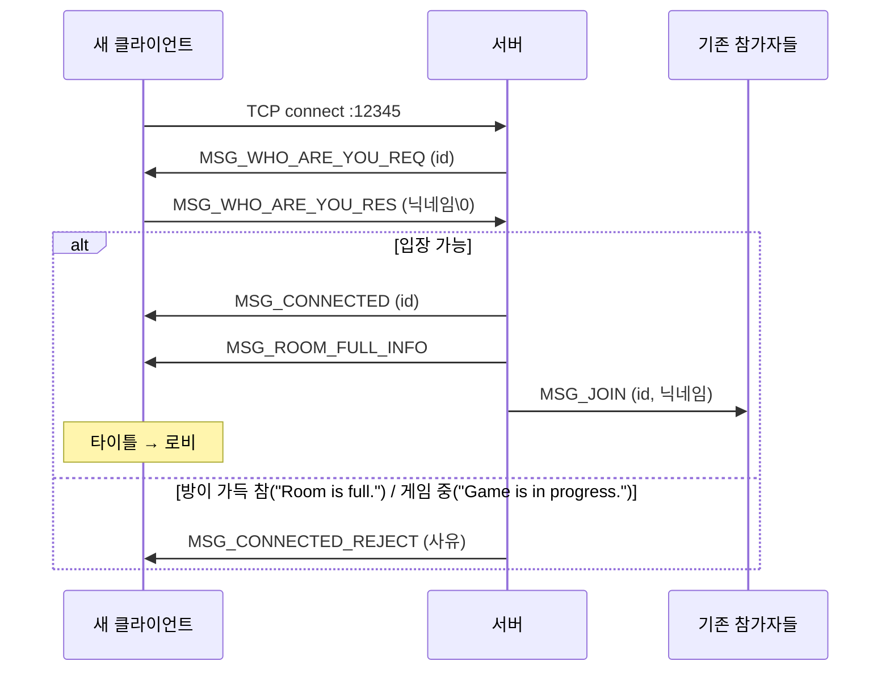
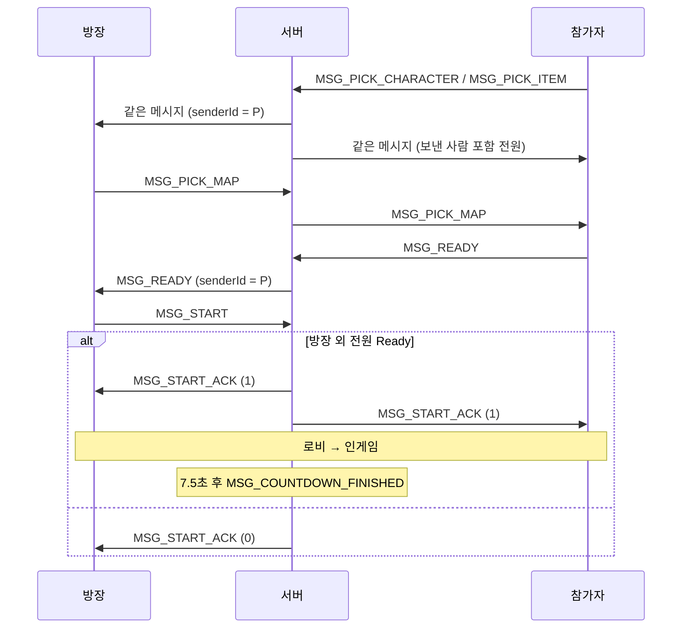
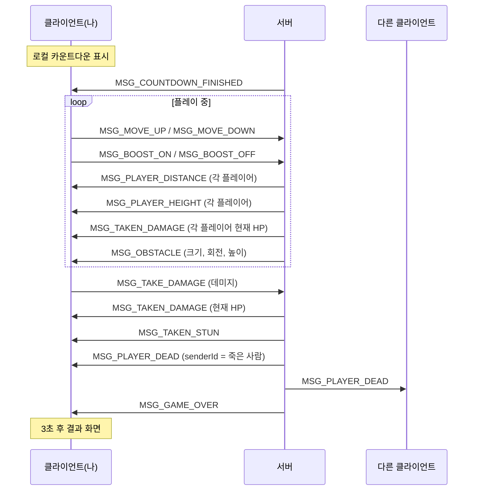

# 05. 서버-클라이언트 프로토콜

멀티플레이는 TCP 하나로 통신합니다. 모든 메시지는 12바이트 헤더 + 가변 바디이고, 값은 C 구조체 메모리를 그대로 보냅니다(x64 Windows, 리틀 엔디언). 정의는 `KDT2Framework/Include/Etc/NetworkManager.h`에 있습니다.

> 서버 쪽 정의는 `Server/Include/Protocol.h`, 서버가 언제 무엇을 보내는지는 [06-server.md](06-server.md#4-메시지-처리-실제-동작)에 있습니다. 서버와 클라이언트의 enum 순서가 다르면 바로 깨지므로, enum은 **양쪽 모두 끝에만 추가**해야 합니다.

## 1. 연결

| 항목 | 값 |
| --- | --- |
| 전송 | TCP (Winsock 2.2) |
| 포트 | 12345 (`NetworkManager.cpp`의 `#define PORT`) |
| 주소 | 전역 `gIPAddress`. 기본 `127.0.0.1`, 메뉴 "방장 IP"로 변경 |
| 수신 | 전용 스레드(`ReceiveThread`)가 헤더 → 바디 순으로 정확히 읽어 큐에 넣음 |
| 하트비트 | 전용 스레드가 1초마다 `MSG_HEARTBEAT`(바디 없음) 전송 |
| 끊김 감지 | `recv`가 0 이하를 반환하면 큐에 `MSG_END`를 넣고 연결 상태를 끔 |

## 2. 패킷 형식

```
+-----------+-----------+-----------+------------------+
| senderId  | msgType   | bodyLen   | body (bodyLen B) |
| int32     | int32     | int32     |                  |
+-----------+-----------+-----------+------------------+
  #pragma pack(push, 1) MessageHeader = 12 bytes
```

- **senderId**: 서버→클라이언트에서는 그 행동을 한 플레이어의 id(시스템 메시지는 0 또는 의미 없음). 클라이언트→서버에서는 대부분 0을 보내고, `MSG_CHANGE_NICKNAME`만 내 id를 넣습니다. 서버는 이 값을 쓰지 않고 소켓으로 보낸 사람을 구분합니다.
- **msgType**: 방향에 따라 `ClientMessage::Type` 또는 `ServerMessage::Type`. 같은 숫자가 방향마다 다른 뜻입니다.
- **bodyLen**: 바디 바이트 수. 0이면 바디 없음.
- 바디의 `int`, `float`는 4바이트, `bool`은 1바이트입니다.

## 3. 클라이언트 → 서버 (`ClientMessage`)

| 값 | 이름 | 바디 | 보내는 곳 / 시점 |
| --- | --- | --- | --- |
| 0 | `MSG_HEARTBEAT` | 없음 | 하트비트 스레드, 1초마다 |
| 1 | `MSG_WHO_ARE_YOU_RES` | `char[]` 닉네임, **널 문자 포함** | `MSG_WHO_ARE_YOU_REQ`를 받으면 즉시 |
| 2 | `MSG_START` | 없음 | 로비, 방장이 다음 버튼 |
| 3 | `MSG_PICK_CHARACTER` | `int` 캐릭터 번호 | 로비, 캐릭터 좌우 버튼 |
| 4 | `MSG_PICK_ITEM` | `int` 슬롯, `int` 아이템 번호 | 로비, 슬롯에 아이템 선택 |
| 5 | `MSG_PICK_MAP` | `int` 맵 번호 | 로비, 맵 좌우 버튼(방장만 보임) |
| 6 | `MSG_READY` | 없음 | 로비, 방장이 아닌 사람이 다음 버튼(Ready 아닐 때) |
| 7 | `MSG_UNREADY` | 없음 | 같은 버튼(Ready 상태일 때) |
| 8 | `MSG_MOVE_UP` | 없음 | 인게임, 마우스 왼쪽 누름 |
| 9 | `MSG_MOVE_DOWN` | 없음 | 인게임, 마우스 왼쪽 뗌 |
| 10 | `MSG_TAKE_DAMAGE` | `float` 데미지(맵 `collision_damage`) | 인게임, 벽/장애물 충돌(스턴/보호 중 아닐 때). Debug 빌드 Z키 |
| 11 | `MSG_BOOST_ON` | 없음 | 인게임, 스페이스 누름 |
| 12 | `MSG_BOOST_OFF` | 없음 | 인게임, 스페이스 뗌 |
| 13 | `MSG_CHANGE_NICKNAME` | `char[]` 닉네임, **널 문자 없음** | 메뉴에서 닉네임 변경(멀티 접속 중) |

## 4. 서버 → 클라이언트 (`ServerMessage`)

"처리" 열은 클라이언트가 받았을 때 하는 일입니다. 공통 처리(`CNetworkManager::ProcessMessage`)는 큐에서 꺼낼 때 먼저 실행되고, 그다음 씬과 리스너가 화면을 갱신합니다.

| 값 | 이름 | 바디 | 처리 |
| --- | --- | --- | --- |
| 0 | `MSG_WHO_ARE_YOU_REQ` | `int` 내 id | `MSG_WHO_ARE_YOU_RES`로 닉네임 응답 |
| 1 | `MSG_CONNECTED` | `int` 내 id | 접속 완료 표시, 내 id 저장 |
| 2 | `MSG_ROOM_FULL_INFO` | 아래 [방 정보](#방-정보-msg_room_full_info) | 참가자 목록, 방장, 맵 설정. 타이틀이면 로비로 이동 |
| 3 | `MSG_DISCONNECT` | `int` 나간 사람 id | 참가자 제거 |
| 4 | `MSG_CONNECTED_REJECT` | `char[]` 사유 | 타이틀: 멀티 모드 끄고 로딩 닫기(사유 표시 안 함) |
| 5 | `MSG_NEW_OWNER` | `int` 새 방장 id | 방장 지정 |
| 6 | `MSG_JOIN` | `int` id + `char[]` 닉네임(나머지 전부) | 참가자 추가 |
| 7 | `MSG_PICK_MAP` | `int` 맵 번호 | 방 맵 변경, 로비 맵 정보 갱신 |
| 8 | `MSG_PICK_ITEM` | `int` 슬롯, `int` 아이템 번호 | senderId 플레이어의 아이템 변경 |
| 9 | `MSG_PICK_CHARACTER` | `int` 캐릭터 번호 | senderId 플레이어의 캐릭터 변경 |
| 10 | `MSG_READY` | 없음 | senderId Ready |
| 11 | `MSG_UNREADY` | 없음 | senderId Ready 해제 |
| 12 | `MSG_START_ACK` | `int` 1(시작) 또는 0 | 1이면 로비 → 인게임 |
| 13 | `MSG_CHANGE_NICKNAME` | `char[]` 닉네임 | senderId 닉네임 변경 |
| 14 | `MSG_COUNTDOWN_FINISHED` | 없음 | 인게임 `Start` 상태 진입 |
| 15 | `MSG_PLAYER_DEAD` | 없음 | senderId 사망. 나면 `Dead` 상태 + 결과 저장, 남이면 해골 표시 |
| 16 | `MSG_GAME_OVER` | `char[]` 문자열(로그용) | 3초 뒤 결과 화면 |
| 17 | `MSG_MOVE_UP` | 없음 | 처리 안 함 |
| 18 | `MSG_MOVE_DOWN` | 없음 | 처리 안 함 |
| 19 | `MSG_PLAYER_DISTANCE` | `float` 거리(m) | senderId 거리 갱신. 나면 내 거리 덮어씀, 남이면 화면 x 위치 계산 |
| 20 | `MSG_PLAYER_HEIGHT` | `float` 높이(월드 y) | senderId 높이 갱신. 남이면 y 위치 이동(내 높이는 무시) |
| 21 | `MSG_TAKEN_DAMAGE` | `float` 현재 HP | senderId HP 갱신. 나면 HP 게이지 반영 |
| 22 | `MSG_TAKEN_STUN` | 없음 | senderId가 나면 스턴 시작 |
| 23 | `MSG_BOOST_ON` | 없음 | 처리 안 함 |
| 24 | `MSG_BOOST_OFF` | 없음 | 처리 안 함 |
| 25 | `MSG_OBSTACLE` | `float` 크기, `float` 회전(도), `float` 높이 | 장애물 하나 생성 |
| 26 | `MSG_HEARTBEAT_ACK` | 없음 | 무시 |
| 27 | `MSG_END` | 없음 | **클라이언트 내부 전용.** 서버가 보내지 않음. 수신 스레드가 끊김을 알릴 때 큐에 넣음. 로비/인게임에서 타이틀로 이동 |

### 방 정보 (`MSG_ROOM_FULL_INFO`)

```
int32  ownerId
int32  mapId
int32  playerCount
repeat playerCount times:          // 플레이어당 81바이트
    int32  id
    bool   ready          (1 byte)
    int32  characterId
    int32  items[3]
    char   nickname[64]   // 널 종료, 남는 칸 포함 항상 64바이트
```

플레이어 레코드는 패딩 없이 붙어 있습니다. 서버가 `bool`을 4바이트로 보내거나 닉네임을 64바이트 고정으로 채우지 않으면 두 번째 플레이어부터 어긋납니다.

## 5. 시퀀스

### 접속과 입장



- 서버는 `MSG_CONNECTED`를 먼저 보냅니다. 클라이언트는 `MSG_ROOM_FULL_INFO`의 `ownerId`를 내 id와 비교해 방장 여부를 정하므로, 순서가 바뀌면 방장이 자기가 방장인 줄 모릅니다.
- 화면 전환은 `MSG_ROOM_FULL_INFO`를 받을 때 일어납니다. 방 정보에는 나 자신도 들어 있습니다.
- 클라이언트는 `MSG_ROOM_FULL_INFO`를 받을 때마다 플레이어를 **추가만** 하므로, 서버는 접속할 때 한 번만 보냅니다.
- 거절할 때 서버는 사유를 보낸 뒤 송신만 닫고 클라이언트가 끊기를 기다립니다. 클라이언트가 보낸 하트비트를 읽지 않고 소켓을 닫으면 RST가 나가 거절 메시지가 유실될 수 있기 때문입니다.

### 로비와 시작



### 인게임



- 서버는 50ms마다 살아 있는 플레이어 각각의 `MSG_PLAYER_DISTANCE`, `MSG_PLAYER_HEIGHT`, `MSG_TAKEN_DAMAGE`(현재 HP)를 전원에게 보냅니다.
- 내 캐릭터의 높이는 클라이언트가 직접 움직이고, 서버에는 버튼 상태만 보냅니다. 서버는 그 입력과 Dex로 높이를 다시 계산해 다른 사람에게 `MSG_PLAYER_HEIGHT`로 알립니다. 서버가 계산한 내 높이는 내 화면에 반영하지 않으므로, 서버와 클라이언트의 높이가 어긋나도 보정되지 않습니다.
- 거리와 HP는 반대로 서버 값이 기준입니다. 클라이언트는 멀티에서 거리/HP를 직접 계산하지 않습니다.
- 충돌 판정은 클라이언트가 합니다. 서버는 받은 데미지에서 Def를 빼서 적용하고, 스턴/보호 중에 온 데미지는 무시합니다.

### 끊김

- 서버나 네트워크가 끊기면 `MSG_END`가 큐에 들어가고, 로비와 인게임 씬은 타이틀로 돌아갑니다.
- 다른 참가자가 나가면 `MSG_DISCONNECT`, 방장이 나가면 `MSG_NEW_OWNER`가 옵니다.

## 6. 클라이언트 구현 요약

| 함수 | 역할 |
| --- | --- |
| `CNetworkManager::ConnetServer()` | WSAStartup, 소켓 생성, connect, 수신/하트비트 스레드 시작 |
| `SendMsg(senderId, type, body, len)` | 헤더 + 바디를 `send` 루프로 전부 전송 |
| `PollMessage(out)` | 큐에서 하나 꺼내 공통 처리 후 반환. false가 나올 때까지 반복 호출 |
| `IsMultiplay()` / `SetIsMultiplay()` | 멀티 모드 여부. 타이틀에서 멀티 플레이를 누를 때 켜짐 |
| `IObjectNetworkController::SendMessageTrigger*` | 바디 없음 / int / float / (slot, item) 송신 헬퍼 |
| `CMultiplayManager` | 받은 메시지로 방 상태(`FPlayerInfo` 목록, 내 id, 방장, 맵, 시작 여부) 유지 |

### 메시지를 새로 추가할 때

1. `ClientMessage` 또는 `ServerMessage` enum의 **끝**(`MSG_END` 앞이 아니라, 서버와 합의한 위치)에 추가하고 서버도 같이 바꿉니다. `ServerMessage::MSG_END`는 클라이언트 내부 값이므로 서버 enum과 겹치지 않게 주의합니다.
2. 바디 레이아웃을 이 문서의 표에 적습니다.
3. 공통 상태 변경은 `CNetworkManager::ProcessMessage`에, 화면 반응은 해당 씬/리스너의 `ProcessMessage`에 넣습니다.
