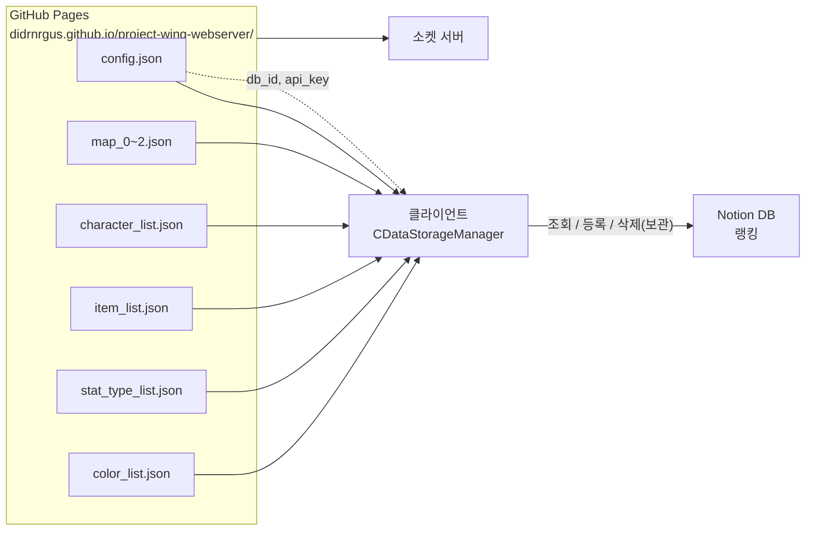
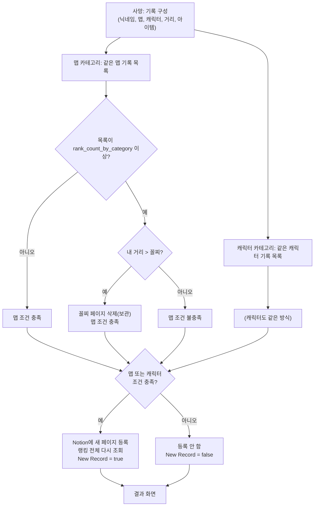

# 07. 게임 데이터와 백엔드

게임 수치(맵, 캐릭터, 아이템, 색)는 코드가 아니라 GitHub Pages에 올린 JSON에 있고, 랭킹은 Notion 데이터베이스에 저장됩니다. 클라이언트와 서버 모두 같은 JSON을 받아 씁니다.



## 1. HTTP 클라이언트 (`Etc/CURL.*`)

`CCURL::SendRequest(url, method, json)`가 모든 HTTP 요청을 처리하고 응답 본문을 문자열로 돌려줍니다.

| 항목 | 동작 |
| --- | --- |
| 인증서 | `CURLOPT_CAINFO = ./pem/cacert.pem` (작업 폴더 기준) |
| GET | 헤더 없이 요청 (웹서버 JSON) |
| POST/PATCH/DELETE | `Authorization: Bearer <config.api_key>`, `Notion-Version: 2022-06-28`, `Content-Type: application/json` 헤더를 붙이고 본문 전송 |
| 응답 코드 | 콘솔에 출력만 하고 실패로 처리하지 않음. 빈 응답만 실패로 봄 |
| 실행 스레드 | 호출한 스레드에서 동기 실행. 게임에서는 항상 작업 스레드에서 호출 |

## 2. 로딩 순서

타이틀 첫 진입 시 `CTitleWidget::LoadGameData()`가 순서대로 받아 `CDataStorageManager`에 저장합니다.

| 순서 | 파일 | 저장 함수 | 결과 |
| --- | --- | --- | --- |
| 1 | `config.json` | `SetConfigData` | `FConfig` |
| 2 | `config.map_file_list`의 각 파일 | `SetMapData` | `index → FMapInfo` |
| 3 | `config.character_file` | `SetCharacterData` | `index → FCharacterState` |
| 4 | `config.item_file` | `SetItemInfoData` | `index → FItemInfo` |
| 5 | `config.stat_file` | `SetStatInfoData` | `name → FStatInfo` |
| 6 | `config.color_file` | `SetColorInfoData` | `color_name → FColorInfo` |
| 7 | Notion DB 조회 | `UpdateUserRankInfos` | `page_id → FUserRankInfo` |

이 밖에 로컬 파일 `KDT2Framework/Bin/Asset/Texture/SpriteSheet/bird_4x1_798x135.json`(Unity 스프라이트 에디터에서 뽑은 프레임 정보)을 `CAnimation2DManager`가 시작할 때 읽습니다.

## 3. JSON 스키마

필드 이름은 클라이언트 파서(`Etc/JsonController.cpp`)가 읽는 키 기준입니다. 없는 키는 건너뛰고 구조체 기본값을 씁니다.

### `config.json` → `FConfig`

| 키 | 타입 | 필드 | 의미 |
| --- | --- | --- | --- |
| `db_id` | string | `DatabaseID` | 랭킹용 Notion 데이터베이스 id |
| `api_key` | string | `APIKey` | Notion 통합(Integration) 토큰 |
| `map_file_list` | string[] | `mapFileNameList` | 맵 JSON 파일 이름들 |
| `character_file` | string | `CharacterFileName` | |
| `item_file` | string | `ItemFileName` | |
| `stat_file` | string | `StatFileName` | |
| `color_file` | string | `ColorFileName` | |
| `selectable_item_count` | int | `SelectableItemCount` | 아이템 슬롯 수(현재 3) |
| `rank_count_by_category` | int | `RankCountByCategory` | 카테고리 값마다 보관할 최대 기록 수 |

> `api_key`가 공개 웹페이지에 그대로 있습니다. 누구나 랭킹 DB를 읽고 쓰고 지울 수 있는 상태입니다. [08-known-issues.md](08-known-issues.md#보안) 참고.

### `map_N.json` → `FMapInfo`

```json
{
  "index": 0,
  "name": "Easy",
  "color_name": "Cyan",
  "difficulty_rate": 10.0,
  "collision_damage": 20.0,
  "obstacle_interval_time": 2.0,
  "line_node_list": [
    { "top_y_pos": 720.0, "bottom_y_pos": 0.0, "item_type": -1, "obstacle_type": -1 }
  ]
}
```

| 키 | 의미 |
| --- | --- |
| `index` | 맵 번호(로비 순서, 랭킹 카테고리 값) |
| `name`, `color_name` | 표시 이름, 테마 색(`color_list`의 이름) |
| `difficulty_rate` | 노드 한 바퀴마다 통로가 위/아래로 각각 좁아지는 px |
| `collision_damage` | 충돌 1회 기본 데미지 |
| `obstacle_interval_time` | 장애물 생성 간격(초) |
| `line_node_list[].top_y_pos`, `bottom_y_pos` | 벽 높이(px). 0 = 화면 아래, 720 = 화면 위. 노드 간 가로 간격은 300px 고정 |
| `line_node_list[].item_type`, `obstacle_type` | 예약 필드. 클라이언트는 읽지 않음 |

### `character_list.json` → `FCharacterState`

```json
{ "character_list": [
  { "index": 0, "name": "Yang", "color_name": "White",
    "speed": 700.0, "hp": 100.0, "dex": 100.0, "def": 10.0, "stun_duration": 2.0,
    "image_sequence_name": "PlayerIdle", "size_x": 200.0, "size_y": 135.0 }
] }
```

각 스탯의 의미는 [01-game-design.md](01-game-design.md#3-스탯)를 보세요. `image_sequence_name`은 `CAnimation2DManager`에 등록된 이름이어야 합니다.

### `item_list.json` → `FItemInfo`

```json
{ "item_list": [
  { "index": 0, "name": "Potion", "stat_type": 0, "add_value": 50.0,
    "desc": "When held, maximum stamina increases." }
] }
```

| 키 | 의미 |
| --- | --- |
| `index` | 아이템 번호. 아이콘은 코드에서 번호로 정함(0 우유, 1 앞 화살표, 2 날개, 3 방패) |
| `stat_type` | 0 HP, 1 Speed, 2 Dex, 3 Def (`EStatInfoText`) |
| `add_value` | 더할 값 |
| `desc` | 툴팁 설명(영어, 로컬라이징 대상 아님) |

### `stat_type_list.json` → `FStatInfo`

```json
{ "stat_type_list": [ { "index": 0, "type": 0, "name": "Hp" } ] }
```

현재 화면 라벨은 로컬라이징 테이블을 쓰므로 이 파일은 보조 정보입니다.

### `color_list.json` → `FColorInfo`

```json
{ "colors": [ { "color_name": "Magenta", "hex": "#FF00FFFF", "r": 1.0, "g": 0.0, "b": 1.0, "a": 1.0 } ] }
```

맵과 캐릭터의 `color_name`은 이 목록에 있는 이름이어야 합니다. 실제 색 변환은 `FVector4D::GetColorFromString()`이 처리합니다.

## 4. Notion 랭킹 DB

### 데이터베이스 속성

| 속성 | Notion 타입 | `FUserRankInfo` 필드 | 값 |
| --- | --- | --- | --- |
| `title` | title | - | 항상 `"Untitled"` |
| `name` | rich_text | `Name` | 닉네임 |
| `map` | number | `Map` | 맵 번호 |
| `character` | number | `Character` | 캐릭터 번호 |
| `distance` | number | `Distance` | 거리(m, 정수로 잘림) |
| `item_0`, `item_1`, `item_2` | number | `Item_0~2` | 슬롯별 아이템 번호(-1 = 빈 칸) |
| (페이지 id) | - | `PageId` | 삭제할 때 씀 |

### 요청

| 동작 | 함수 | HTTP |
| --- | --- | --- |
| 전체 조회 | `CNotionDBController::ReadRecords` | `POST https://api.notion.com/v1/databases/{db_id}/query`, 본문 `{}` |
| 등록 | `CreateUserRecord` | `POST https://api.notion.com/v1/pages` |
| 삭제 | `DeleteRecord` | `PATCH https://api.notion.com/v1/pages/{page_id}`, 본문 `{"archived": true}` (보관 처리) |

조회 결과는 `CDataStorageManager::mUserRankInfosByPageId`에 캐시되고, 화면은 이 캐시를 `GetArrayUserRankByCategory(카테고리, 값)`로 걸러 거리 내림차순으로 씁니다.

## 5. 랭킹 등록 알고리즘

싱글플레이에서 사망하면 3초 뒤 작업 스레드에서 `CreateUserRecord(기록)`을 호출합니다.



- 두 카테고리 중 하나라도 순위권이면 등록합니다. 한 기록이 맵 순위와 캐릭터 순위에 동시에 쓰입니다.
- 꼴찌 삭제는 등록 여부가 정해지기 전에 카테고리별로 바로 실행됩니다. 이 방식의 부작용은 [08-known-issues.md](08-known-issues.md#랭킹)에 정리했습니다.
- 멀티플레이 결과는 등록하지 않습니다.

## 6. 데이터 관련 작업 방법

| 하고 싶은 것 | 바꿀 곳 |
| --- | --- |
| 수치 조정(속도, HP, 데미지 등) | 웹서버 JSON만 수정. 클라이언트/서버 재빌드 불필요. 다음 실행부터 반영 |
| 맵 모양 변경 | `map_N.json`의 `line_node_list` |
| 슬롯 수 변경 | `config.selectable_item_count`. 단, `FUserRankInfo`와 Notion 속성은 아이템 3개 고정이고 `PLAYER_ITEM_COUNT_MAX`(3)와 멀티 패킷도 3개 고정이므로 3보다 크게 하려면 코드 수정 필요 |
| 랭킹 보관 수 변경 | `config.rank_count_by_category` |
| 랭킹 초기화 | Notion DB에서 페이지 삭제 |
| 웹서버 주소 변경 | `Etc/CURL.h`의 `WEBSERVER_PATH`(클라이언트)와 서버 코드 |
