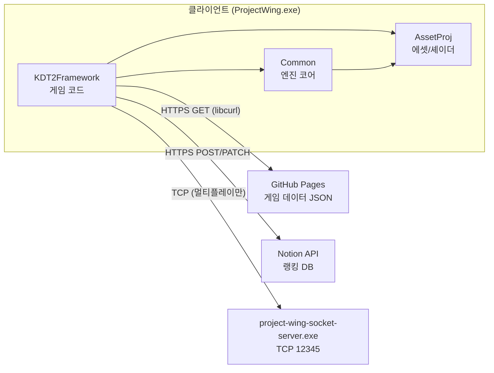

# ProjectWing 문서

ProjectWing은 위아래 벽 사이를 날며 장애물을 피하고, 비행 거리로 순위를 겨루는 2D 횡스크롤 게임입니다. 자체 C++/DirectX 11 프레임워크 위에서 동작하며 싱글플레이와 최대 5인 멀티플레이를 지원합니다.

빌드 방법과 코딩 관례는 루트의 [CLAUDE.md](../CLAUDE.md)에 있습니다. 이 폴더는 기능 단위의 상세 문서입니다.

## 목차

| 문서 | 내용 | 주 독자 |
| --- | --- | --- |
| [01-game-design.md](01-game-design.md) | 기획: 조작, 스탯 공식, HP/스턴/사망 규칙, 맵 난이도, 장애물, 캐릭터/아이템, 싱글과 멀티의 규칙 차이 | 기획, 전원 |
| [02-screens-and-flow.md](02-screens-and-flow.md) | 화면별 기능과 전환 흐름: 타이틀, 로비, 인게임, 결과, 랭킹, 윈도우 메뉴 | 기획, 클라이언트 |
| [03-client-engine.md](03-client-engine.md) | 엔진(Common, AssetProj): 메인 루프, 씬 수명주기, 오브젝트/컴포넌트, 충돌, UI, 에셋, 스레드, Debug/Release 차이 | 클라이언트 |
| [04-client-gameplay.md](04-client-gameplay.md) | 게임 코드(KDT2Framework): 씬/오브젝트/위젯 클래스별 책임, 인터페이스, 인게임 객체 연결 | 클라이언트 |
| [05-network-protocol.md](05-network-protocol.md) | 서버-클라이언트 프로토콜: 패킷 헤더, 메시지 목록과 바디 레이아웃, 시퀀스 | 클라이언트, 서버 |
| [06-server.md](06-server.md) | 소켓 서버(`Server/Include`): 빌드, 실행 방식, 구조, 메시지별 실제 동작, 검증 방법 | 서버 |
| [07-data-and-backend.md](07-data-and-backend.md) | 게임 데이터 JSON 스키마(GitHub Pages), 로딩 순서, Notion 랭킹 DB와 등록 알고리즘 | 클라이언트, 기획 |
| [08-known-issues.md](08-known-issues.md) | 코드 분석 중 발견한 버그, 위험 요소, 불일치 | 전원 |
| [09-release.md](09-release.md) | GitHub Actions 자동 릴리즈: 트리거, 버전 규칙, 빌드 환경, 배포 zip 구성 | 전원 |

## 한눈에 보는 구조

- 싱글플레이는 서버 없이 클라이언트 혼자 모든 규칙을 계산합니다.
- 멀티플레이는 방장 클라이언트가 서버 exe를 자식 프로세스로 띄우고, 모든 참가자(방장 포함)가 그 서버에 TCP로 접속합니다. 거리, HP, 장애물은 서버가 계산합니다.
- 시작할 때 게임 데이터 JSON(GitHub Pages)과 랭킹(Notion)을 받아오므로 인터넷이 필요합니다.

## 문서 기준

- 기준 시점: 2026-11-24, `main` 브랜치 작업 트리(커밋되지 않은 로컬라이징 변경 포함).
- 이 작업 트리 기준으로 Debug/Release x64 빌드가 성공하고, 클라이언트가 실행되는 것까지 확인했습니다(2026-11-24). 게임 규칙과 화면 동작은 코드를 읽고 정리한 것이며 플레이로 하나하나 확인한 것은 아닙니다.
- 서버 소스는 `Server/Include/`에 있습니다. 원본 서버 소스가 유실되어 클라이언트 프로토콜 기준으로 다시 작성했고, 원본과 다른 부분은 [06-server.md](06-server.md)에 정리했습니다.
- 수치(속도, HP 등)의 실제 값은 웹서버 JSON에 있고 바뀔 수 있습니다. 문서의 예시 값은 코드 주석에 남아 있던 샘플입니다.
